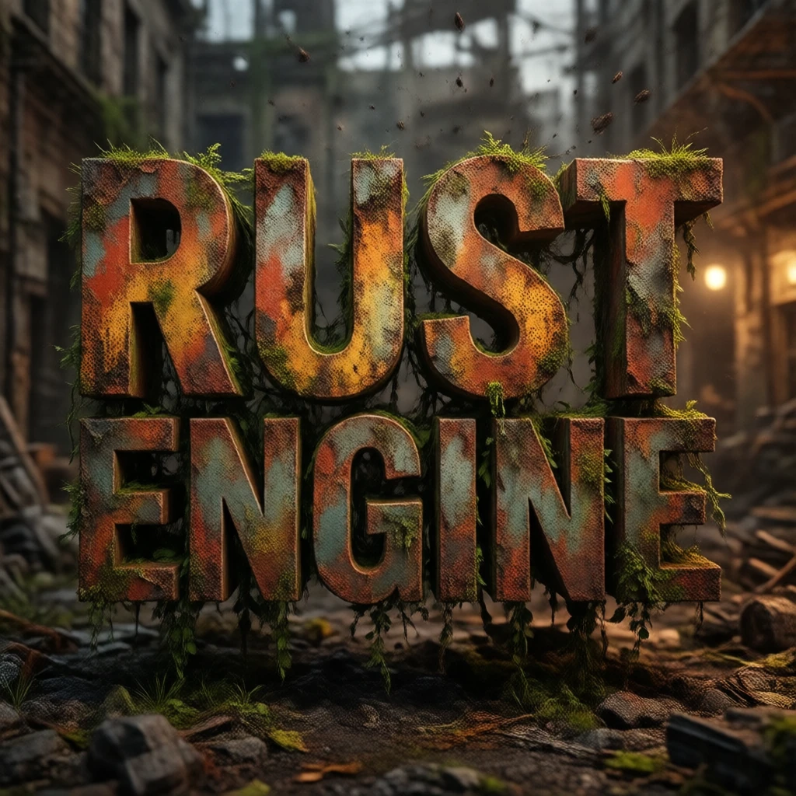

# RE — Rust Engine

[English](README.md) | Deutsch



Open-Source-Spiel-Engine: Engine-Laufzeit und Editor in Rust, Dienste
und Werkzeuge (Server, Buildfarmen, Launcher) in Go. Eine Codebasis für
PC und Web, Konsolen-Backends andockbar. Rendering über wgpu aus einer
einzigen Shader-Quelle (WGSL); Engine-Funktionen sind als typisierte
Capabilities exponiert und können von Skripten, Editoren und KI-Agenten
direkt aufgerufen werden.

RE ist aus einem Worldbuilder genannten Level-Editor hervorgegangen und
hat dessen Datenmodell übernommen: Szenengraf, Meshes, Materialien mit
Texturen, Animationen/Skelette, Terrain und Tilesets, glTF-2.0-Pipeline.

**Leitfeature der Architektur:** ein Strategiespiel, das ohne
Ladebildschirm und ohne Schnitt aus der Übersicht in die Ego-Perspektive
einer Einheit wechselt — die Kamera fliegt auf die Einheit zu und übergibt
dabei die Steuerung. Details: [docs/architecture.de.md](docs/architecture.de.md).

**Status:** frühe Entwicklung. Kern-Datenmodell, Import/Export und das
erste Backend sind funktionsfähig; Fenster-Layer, ECS, Audio/Physik und
Editor entstehen Meilenstein für Meilenstein (siehe unten).

## Crates

| Crate | Zweck | Status |
|---|---|---|
| `re-core` | Datenmodell: Szene, Mesh, Material, Animation, Terrain, Tilesets | fertig |
| `re-io` | glTF-2.0-Import/Export inkl. Textur-Einbettung | fertig |
| `re-ecs` | Entity-Component-System: Welt, Sparse-Set-Speicher, Schedule | in Arbeit |
| `re-render` | Backend-neutrale Render-Schicht (`GfxBackend`), Kamera, Billboards | in Arbeit |
| `re-wgpu` | wgpu-Backend: Vulkan/Metal/WebGPU (DirectX über wgpu), Offscreen und Fenster | in Arbeit |
| `re-platform` | Fenster, Eingabe, Event-Loop, Zeit (winit; headless für Tests) | in Arbeit |
| `re-agent` | Capability-Registry + Anbindung von KI-Providern (Ollama, llama.cpp, OpenAI-kompatibel, Anthropic) | Gerüst |

Geplant: `re-editor` (M4), natives Backend `re-native` (M6/M7 für
Raytracing und DLSS), `re-audio`/`re-vfx`/`re-physics` (M8), Go-Dienste
unter `services/` (M9).

## Schnellstart

```sh
cargo build --workspace
cargo test --workspace
```

Headless-Builds ohne Fenster-Bibliotheken:
`cargo build -p re-wgpu --no-default-features`.

## Architektur-Prinzipien

- **Eine Shader-Quelle.** Alle Pipeline-Varianten laufen auf WGSL über
  wgpu; Linux/Vulkan ist Erstziel, DirectX und WebGPU folgen dem Backend.
- **Eine Fähigkeitsschicht.** Editor-Werkzeuge, Konsolenbefehle und
  KI-Aufrufe teilen sich dieselbe Registry mit JSON-Schemata und
  Berechtigungs-Hook: [docs/ki-integration.de.md](docs/ki-integration.de.md).
- **Ein Prozess, ein VRAM-Budget.** Inhaltsgenerierung läuft als
  Modul der Engine, nicht als zweites Programm, das um den
  Grafikspeicher konkurriert: [docs/vram.de.md](docs/vram.de.md).
- **Schnittstelle statt Gestrüpp.** Backends (Grafik, Plattform, Audio)
  implementieren öffentliche Traits; plattformspezifischer Code ist
  austauschbar angekoppelt.

## Meilensteine

- **M0** — Repo, Workspace, Kern-Datenmodell und glTF-Pipeline ✅
- **M1** — `re-render` + `re-wgpu`: Szenen mit glTF-Texturen rendern (Offscreen) ✅
- **M2** — `re-platform`: Fenster, Eingabe, Delta-Time, Surface-Rendering ✅
- **M3** — ECS + Welt-Streaming: World-Partition, LOD/HLOD, asynchrone Lade-Pipeline, MCP-Werkzeuge für Agenten
- **M4** — Editor: Szenen-View, Outliner, Inspector, Import-Pipelines, Undo
- **M5** — Render-Pipeline V2: Deferred HDR, Schatten 2.0, Upscaling-Adapter (FSR/XeSS/DLSS) ([docs/rendering.de.md](docs/rendering.de.md))
- **M6** — Dynamische GI und Reflexionen: Lumen-artiger Software-RT-Pfad, Hardware-RT optional
- **M7** — Pfad-Verfolgung und Ray-Reconstruction (progressiv, Offline-Modus, Bake-Ausgaben)
- **M8** — Audio (SFX-Events), VFX (GPU-Partikel, Effekt-Graphen), Physik, Animation
- **M9** — Go-Dienste (Netcode, dedizierter Server, Buildfarm) + WebGPU-Build
- **M10** — Konsolen-Backends (private SDK-Module), Publishing
- **Leitfeature** — Strategie↔Ego: Kameraflug in die Einheit ohne Ladebildschirm (Quality-Tiers aus M3, Timeline aus [docs/cinema.de.md](docs/cinema.de.md))

## Konsolen

Offene Ziele (PSP, Nintendo-Switch-Homebrew u. ä.) werden vollständig in
diesem Repo geführt. Für Devkit-Ziele gilt das in der Branche übliche
Muster: Dieses Repo definiert nur die Backend-Traits; die
SDK-abhängige Implementierung bleibt im privaten Repo des jeweiligen
NDA-Inhabers und wird dagegen gebaut.

## Beitragen

Issues und Diskussionen gern vor größeren Änderungen. Commits klein
halten, `cargo test --workspace` muss grün sein.

## Lizenz

MIT — Copyright (c) 2026 Waldemar Friesen. Wer dieses Projekt oder Teile
davon weiterverbreitet (auch veränderte Fassungen) muss den Copyright-
Vermerk und den Lizenztext unverändert übernehmen; siehe [LICENSE](LICENSE).

Eine freundliche Bitte — völlig freiwillig und keine Bedingung: Wenn ein
Spiel oder Werkzeug mit dieser Engine entsteht, würde ich mich über einen
Credit freuen („Powered by the RE Rust Engine" im Abspann, ein Link auf
dieses Repository oder ein Stern darauf).
