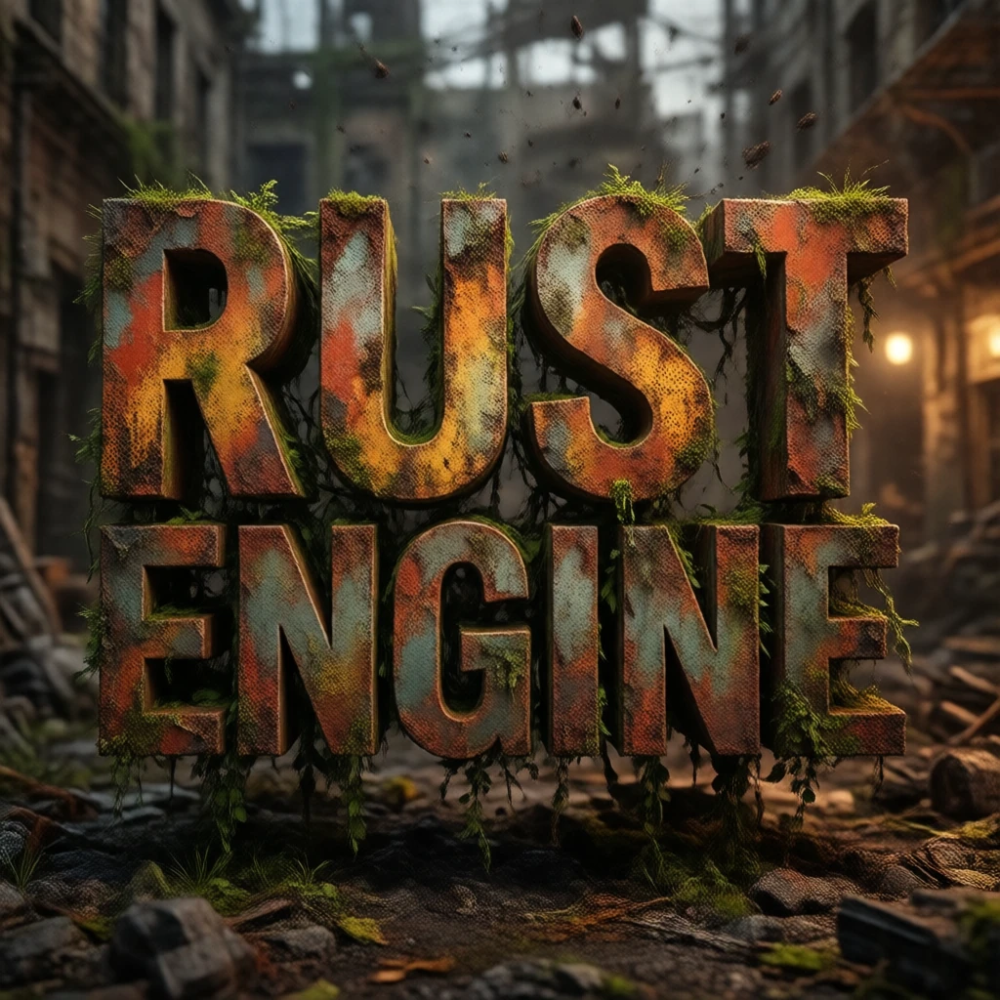

# RE — Rust Engine

English | [Deutsch](README.de.md)



Open-source game engine: engine runtime and editor in Rust, services and
tools (servers, build farms, launchers) in Go. One codebase for PC and
web, with console backends that can be attached. Rendering runs on wgpu
from a single shader source (WGSL); every engine function is exposed as
a typed capability that scripts, editors and AI agents can call
directly.

RE grew out of a level editor called Worldbuilder and adopted its data
model: scene graph, meshes, materials with textures, animations and
skeletons, terrain and tilesets, plus a glTF 2.0 pipeline.

**The signature feature this architecture is built around:** a strategy
game that drops from the top-down overview into a unit's first-person
view with no loading screen and no cut — the camera flies onto the unit
and hands over control on the way. Details:
[docs/architecture.md](docs/architecture.md).

**Status:** early development. The core data model, import/export and
the first backend are working; the window layer, ECS, audio/physics and
the editor are coming together milestone by milestone (see below).

## Crates

| Crate | Purpose | Status |
|---|---|---|
| `re-core` | Data model: scene, mesh, material, animation, terrain, tilesets | done |
| `re-io` | glTF 2.0 import/export incl. texture embedding | done |
| `re-ecs` | Entity-component-system: world, sparse-set storage, schedule | in progress |
| `re-render` | Backend-neutral render layer (`GfxBackend`), camera, billboards | in progress |
| `re-wgpu` | wgpu backend: Vulkan/Metal/WebGPU (DirectX via wgpu), offscreen and windowed | in progress |
| `re-platform` | Windows, input, event loop, time (winit; headless for tests) | in progress |
| `re-agent` | Capability registry + AI provider bindings (Ollama, llama.cpp, OpenAI-compatible, Anthropic) | scaffold |

Planned: `re-editor` (M4), native backend `re-native` (M6/M7 for ray
tracing and DLSS), `re-audio`/`re-vfx`/`re-physics` (M8), Go services
under `services/` (M9).

## Quick start

```sh
cargo build --workspace
cargo test --workspace
```

Headless builds without window libraries:
`cargo build -p re-wgpu --no-default-features`.

## Architecture principles

- **One shader source.** All pipeline variants run on WGSL through wgpu;
  Linux/Vulkan is the primary target, DirectX and WebGPU follow from the
  backend.
- **One capability layer.** Editor tools, console commands and AI calls
  share the same registry with JSON schemas and a permission hook:
  [docs/ki-integration.md](docs/ki-integration.md).
- **One process, one VRAM budget.** Content generation runs as a module
  of the engine, not as a second program competing for video memory:
  [docs/vram.md](docs/vram.md).
- **Interfaces, not spaghetti.** Backends (graphics, platform, audio)
  implement public traits; platform-specific code is attached in a
  swappable way.

## Milestones

- **M0** — repo, workspace, core data model and glTF pipeline ✅
- **M1** — `re-render` + `re-wgpu`: render scenes with glTF textures (offscreen) ✅
- **M2** — `re-platform`: windows, input, delta time, surface rendering ✅
- **M3** — ECS + world streaming: world partition, LOD/HLOD, async loading pipeline, MCP tools for agents
- **M4** — editor: scene view, outliner, inspector, import pipelines, undo
- **M5** — render pipeline V2: deferred HDR, shadows 2.0, upscaling adapters (FSR/XeSS/DLSS) ([docs/rendering.md](docs/rendering.md))
- **M6** — dynamic GI and reflections: Lumen-style software ray-tracing path, hardware RT optional
- **M7** — path tracing and ray reconstruction (progressive, offline mode, baked outputs)
- **M8** — audio (SFX events), VFX (GPU particles, effect graphs), physics, animation
- **M9** — Go services (netcode, dedicated server, build farm) + WebGPU build
- **M10** — console backends (private SDK modules), publishing
- **Signature feature** — strategy↔first-person: camera flight into the unit with no loading screen (quality tiers from M3, timeline from [docs/cinema.md](docs/cinema.md))

## Consoles

Open targets (PSP, Nintendo Switch homebrew and the like) are tracked
entirely in this repo. For devkit targets the usual industry pattern
applies: this repo only defines the backend traits; the SDK-dependent
implementation stays in the private repo of the respective NDA holder
and is built against them.

## Contributing

Issues and discussions are welcome before larger changes. Keep commits
small; `cargo test --workspace` must stay green.

## License

MIT — Copyright (c) 2026 Waldemar Friesen. Anyone redistributing this
project or parts of it (including modified versions) must carry the
copyright notice and the license text unchanged; see
[LICENSE](LICENSE).

A friendly request — entirely voluntary and not a condition: if a game
or tool is built with this engine, I would be glad about a credit
(„Powered by the RE Rust Engine" in the credits, a link to this
repository, or a star on it).
